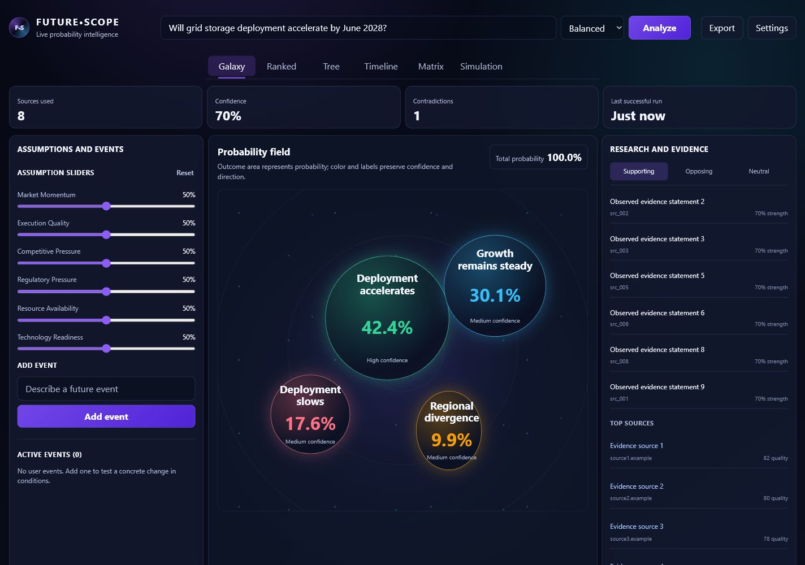
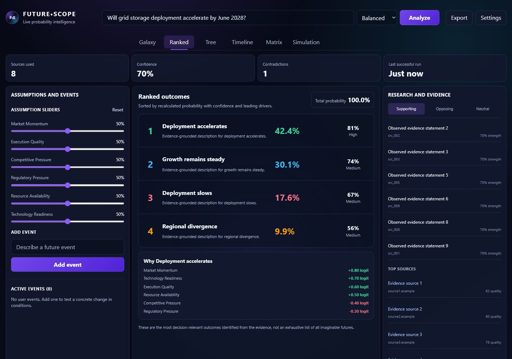
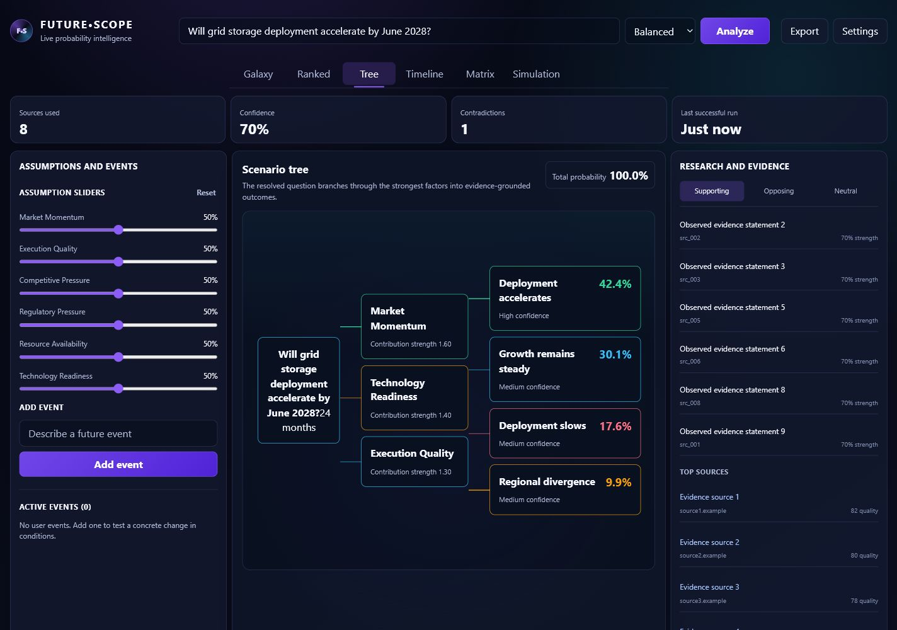
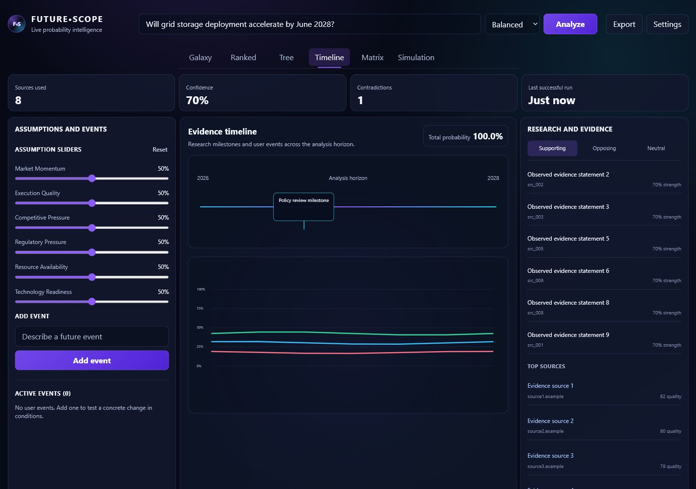
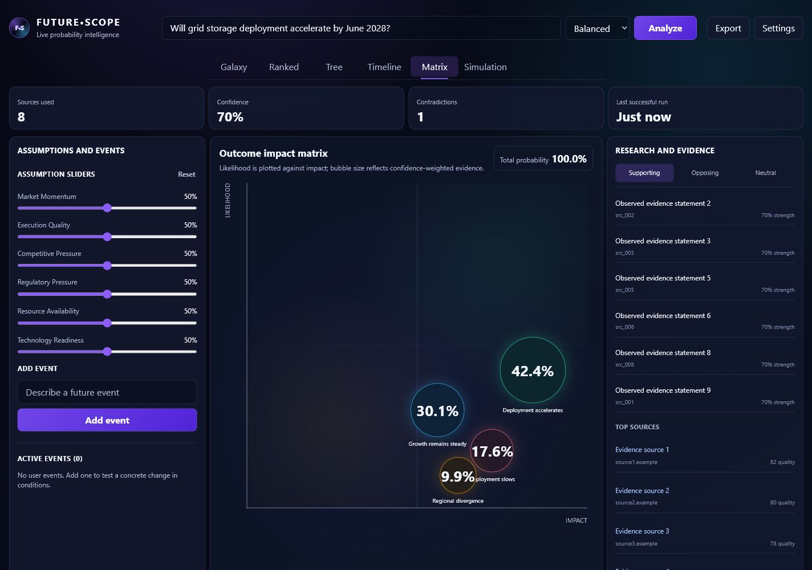
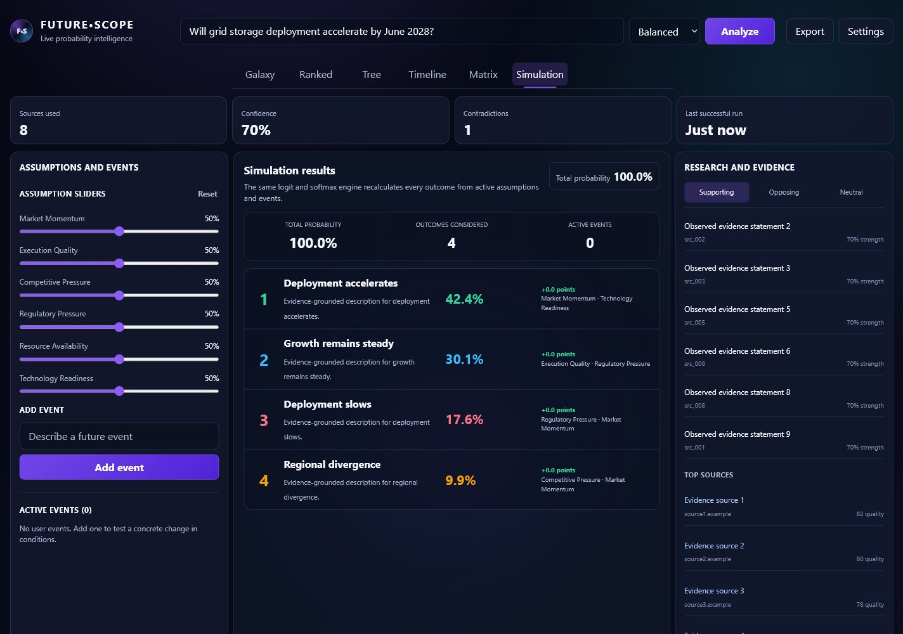
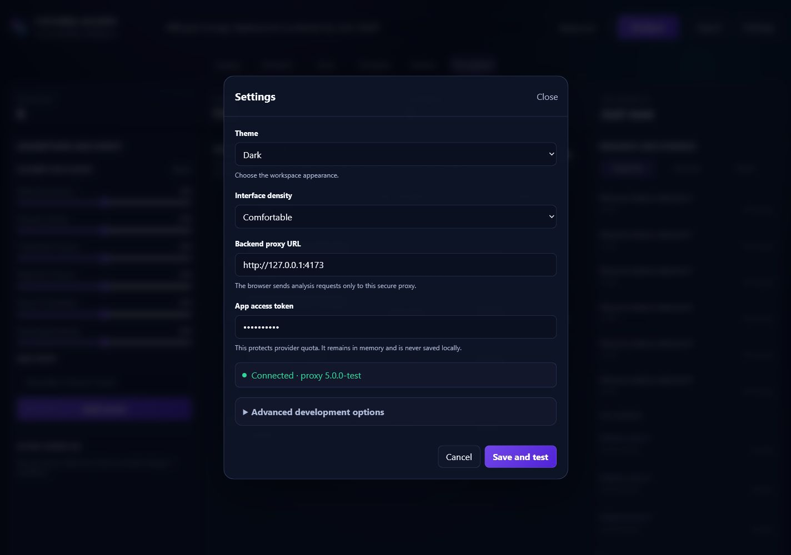

# Future•Scope V5

Future•Scope is a live-only, source-grounded forecasting workspace. It begins empty, researches a bounded question through Brave Search, uses MiniMax agents to structure evidence and outcomes, and recalculates probabilities through one deterministic logit/softmax engine.

## Interface tour

These screenshots use controlled local contract data so the complete interface can be reviewed without exposing provider credentials or embedding a default forecast in production.

### Galaxy

The probability field sizes outcomes by probability while preserving direction, confidence, and immediate comparison.



### Ranked

The ranked view combines recalculated probability, confidence, leading drivers, and the strongest outcome's factor contributions.



### Tree

The scenario tree connects the resolved question to its strongest factors and evidence-grounded outcomes.



### Timeline

The timeline places milestones across the analysis horizon and plots probability movement through time.



### Matrix

The impact matrix compares likelihood and consequence while scaling each bubble by confidence-weighted evidence.



### Simulation

The simulation view exposes the deterministic recalculation results, active event count, and point changes for every outcome.



### Settings

Settings configure appearance and the secure Worker connection. The app access token is session-only, masked, and never stored in localStorage.



## What is included

`index.html` is the complete browser application with embedded CSS and JavaScript. `proxy/worker.js` is the Cloudflare Worker entry point. The proxy owns provider credentials, app authentication, rate limiting, validation, error mapping, request IDs, security headers, and structured logs.

The seven screenshots from the supplied V5 document were used only as layout references. No visible scenario from those screenshots is present in production code or initial state.

## Local setup

Install the exact locked dependencies:

```powershell
npm ci
```

Copy `.dev.vars.example` to `.dev.vars`, replace the placeholders, and keep that file uncommitted. Generate two independent random values for `APP_AUTH_TOKEN` and `IP_HASH_PEPPER`; for example:

```powershell
[Convert]::ToBase64String([Security.Cryptography.RandomNumberGenerator]::GetBytes(32))
```

Start the Worker:

```powershell
npm run dev
```

Serve `index.html` from an HTTP origin such as `http://localhost:4173`, then set `ALLOWED_ORIGIN` in `wrangler.jsonc` to the exact frontend origin. Open Settings in Future•Scope, enter the Worker URL and the same `APP_AUTH_TOKEN`, then choose **Save and test**.

The app token is not a Brave, MiniMax, or Cloudflare account credential. It is a gate between the browser and this proxy so an arbitrary visitor cannot spend the configured provider quota. It remains in browser memory and is intentionally not stored in localStorage.

## Verification

```powershell
npm run check
npm test
npm run test:e2e
npm audit --omit=dev
npx wrangler deploy --dry-run
```

The browser suite uses a controlled local upstream contract server. It verifies the complete application flow without placing generated forecast data in production source.

## Keyboard order

The primary order is brand-independent and task-first: forecast question, research depth, Analyze, Export when available, Settings, view tabs, factor sliders, event controls, evidence filters and source links. Dialog focus begins at the first editable field and returns to the invoking control when closed. Arrow keys move between enabled view tabs; Home and End move to the first and last tabs.

## Deployment

Deploy the Worker only after adding Cloudflare secrets:

```powershell
npx wrangler secret put BRAVE_SEARCH_API_KEY
npx wrangler secret put MINIMAX_API_KEY
npx wrangler secret put APP_AUTH_TOKEN
npx wrangler secret put IP_HASH_PEPPER
npm run deploy
```

Publish `index.html` and `_headers` on a static HTTPS host. Set `ALLOWED_ORIGIN` to that exact origin. The two rate-limit namespace IDs in `wrangler.jsonc` are application-defined integers and must remain unique within the Cloudflare account.

## Credential safety

Never commit `.dev.vars`, `.env`, provider keys, Cloudflare API tokens, or app tokens. Rotate any credential pasted into chat, issue trackers, logs, or terminal transcripts before production use.

## Current provider contracts

The implementation was verified on June 18, 2026 against the official MiniMax OpenAI-compatible API and Brave Web Search API. MiniMax uses `MiniMax-M3` at `https://api.minimax.io/v1/chat/completions` with Bearer authentication. Brave custom freshness ranges use `YYYY-MM-DDtoYYYY-MM-DD`.

Official references:

- [MiniMax OpenAI-compatible text API](https://platform.minimax.io/docs/api-reference/text-openai-api)
- [Brave Web Search API](https://api-dashboard.search.brave.com/app/documentation/web-search/get-started)
- [Cloudflare Workers rate-limit bindings](https://developers.cloudflare.com/workers/runtime-apis/bindings/rate-limit/)
- [Cloudflare Worker secrets](https://developers.cloudflare.com/workers/configuration/secrets/)
