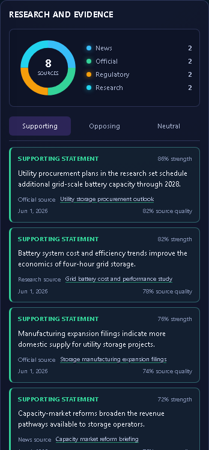
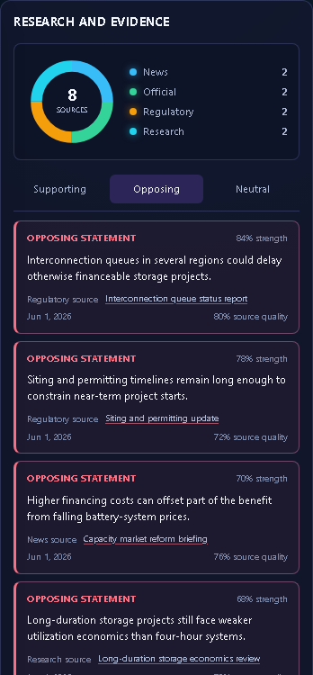
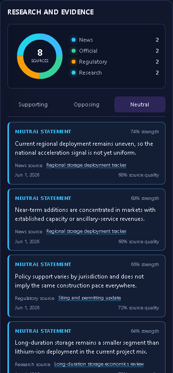

# Future•Scope

Future•Scope is a live-only, source-grounded forecasting workspace. It turns a bounded question into MiniMax-native research, validated evidence, calibrated outcomes, and a deterministic logit/softmax simulation. The browser calls only the secure Cloudflare Worker and never receives the provider credential.

## Interface tour

The screenshots below were captured from the complete browser test flow using the question:

> Will grid storage deployment accelerate by June 2028?

The controlled analysis contract supplies source-typed evidence, contradictions, four calibrated outcomes, six factor models, and a dated policy milestone. It exercises the same browser and Worker payload contract as production without exposing credentials or embedding forecast data in the application.

### Galaxy

The probability field sizes outcomes by probability while preserving direction, confidence, immediate comparison, factor controls, and source composition. The evidence ledger separates supporting, opposing, and neutral statements and shows each complete claim with its named source, date, strength, and quality.


### Evidence ledger

Every evidence tab presents identified statements rather than opaque evidence IDs. Claims retain their stance, source attribution, date, strength, and source-quality context.

| Supporting | Opposing | Neutral |
| --- | --- | --- |
|  |  |  |

### Ranked

The ranked view combines recalculated probability, confidence, leading drivers, and coverage notes.


### Tree

The scenario tree connects the resolved question to its strongest factors and assigns each outcome to one branch. Rounded SVG trunks, glowing ports, and directional arrowheads mirror the original visual language without crossing every factor into every outcome.


### Timeline

The timeline presents research and user events as neon milestones across the analysis horizon and plots probability movement through time.


### Matrix

The impact matrix compares likelihood and consequence while scaling each bubble by confidence-weighted evidence.


### Simulation

The simulation view exposes deterministic recalculation, active events, probability changes, and leading drivers.


### Settings

Settings contains only Theme, Backend Proxy URL, App Access Token, Connection Status, Save & Test, and Cancel. The app token is session-only and never stored in localStorage.


## Architecture

`index.html` is the self-contained browser application. `proxy/worker.js` is the Cloudflare Worker entry point. The Worker owns MiniMax authentication, app-token validation, rate limiting, source normalization, schema validation, error mapping, request IDs, security headers, and structured logs.

The research pipeline runs A0 through A9. A1 creates research tasks, A2 performs MiniMax native research, A3 scores source quality, A4 extracts evidence, A5 audits contradictions and recency, A6 enumerates outcomes, A7 forecasts logits, A8 calibrates confidence, and A9 builds the simulation model.

The application starts empty by design. It contains no demo mode, canned outcomes, screenshot-derived scenario, or fallback forecast payload.

## Local setup

Install the locked dependencies:

```powershell
npm ci
```

Copy `.dev.vars.example` to `.dev.vars`, replace the placeholders, and keep the file uncommitted. Generate independent values for `APP_AUTH_TOKEN` and `IP_HASH_PEPPER`:

```powershell
[Convert]::ToBase64String([Security.Cryptography.RandomNumberGenerator]::GetBytes(32))
```

Start the Worker:

```powershell
npm run dev
```

Serve `index.html` from an HTTP origin such as `http://localhost:4173`, then set `ALLOWED_ORIGIN` in `wrangler.jsonc` to that exact frontend origin. Open Settings, enter the Worker URL and matching `APP_AUTH_TOKEN`, then choose **Save and test**.

The app token is not a MiniMax or Cloudflare credential. It gates browser access to the configured Worker and remains only in browser memory.

## Verification

```powershell
npm run check
npm test
npm run test:e2e
npm audit --omit=dev
npx wrangler deploy --dry-run
```

The browser suite uses a controlled local upstream contract server and verifies the complete application flow without placing generated forecast data in production source.

## Deployment

Add the required Worker secrets:

```powershell
npx wrangler secret put MINIMAX_API_KEY
npx wrangler secret put APP_AUTH_TOKEN
npx wrangler secret put IP_HASH_PEPPER
npm run deploy
```

Publish `index.html` and `_headers` on a static HTTPS host. Set `ALLOWED_ORIGIN` to that exact origin.

Recommended repository rename:

```text
benclawbot/future-scope-v5 → benclawbot/future-scope
```

## Credential safety

Never commit `.dev.vars`, `.env`, provider keys, Cloudflare API tokens, or app tokens. Rotate any credential pasted into chat, issue trackers, logs, or terminal transcripts before production use.

## Current provider contracts

MiniMax uses `MiniMax-M3` by default at `https://api.minimax.io/v1/chat/completions` with Bearer authentication. The Worker may override the model and endpoint with `MINIMAX_MODEL` and `MINIMAX_API_BASE_URL`.

Official references:

- [MiniMax OpenAI-compatible text API](https://platform.minimax.io/docs/api-reference/text-openai-api)
- [Cloudflare Workers rate-limit bindings](https://developers.cloudflare.com/workers/runtime-apis/bindings/rate-limit/)
- [Cloudflare Worker secrets](https://developers.cloudflare.com/workers/configuration/secrets/)
